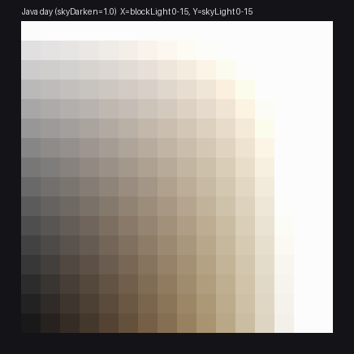
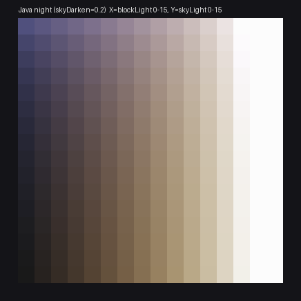
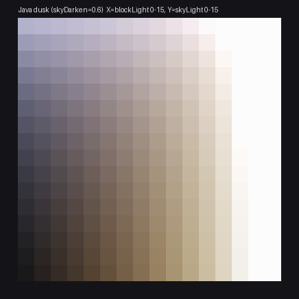

# JavaLighting

让 **Minecraft 基岩版（Bedrock）** 的方块光照与实体阴影更接近 **Java 版** 的观感，面向：

| 组件 | 版本 |
| --- | --- |
| Minecraft Bedrock Edition | **1.26.51.01**（Windows x64） |
| LeviLamina | **26.51.9**（客户端 / client 构建） |

工程包含两个互补的部分：

1. **`java-lighting` 原生客户端模组（C++ / LeviLamina）**
   - 把 Java 版 `LightTexture` 的光照贴图算法**逐行移植**为 C++（`src/lighting/JavaLightmap.*`），并用 Python 参考实现 + 数值表交叉校验。
   - 通过 LeviLamina 的实例钩子拦截 `BaseLightTextureImageBuilder::buildImage`（基岩版 CPU 侧光照贴图生成函数），
     在**传统图形模式**下把基岩版生成的 16×16 光照贴图替换为 Java 版等价结果。
   - `observe` 模式先只观测、导出基岩版贴图，确认轴向/朝向后再切换 `java` 模式 —— 避免"一上来就乱改画面"。
2. **`resource_pack/` Vibrant Visuals 预设资源包**
   - 在基岩版 **Vibrant Visuals（延迟渲染）** 模式下，用官方数据驱动 JSON 调整：
     阴影风格、太阳/月亮照度与颜色、环境光、天空光强度、方块光源颜色与类型、PBR 兜底（去掉 Java 版没有的金属/高光）。
   - 这些数值由 `tools/gen_reference.py` 依据 Java 版光照曲线推导生成，可复现。

两条路线互不冲突：**Vibrant Visuals 开 → 资源包生效；传统图形 → 原生光照贴图钩子生效。**

> ⚠️ 诚实说明：本工程在离线环境完成，**没有在本机编译、也没有实机运行 Bedrock**。
> 编译由 `.github/workflows/build.yml`（xmake + LLVM 22）负责；实机验证步骤见 [docs/TESTING.md](docs/TESTING.md)。
> `BaseLightTextureImageBuilder` 的类布局/方法签名来自 LeviLamina 26.51 的 Bedrock 头文件，但
> `$buildImage` thunk 是否在 26.51.9 客户端导出、光照贴图像素布局是否如我们假设，必须由你在实机用
> `observe` 模式确认。钩子安装失败时模组会记录错误并继续运行，不会造成崩溃。

---

## Java 版光照贴图（参考数据）

由 `tools/gen_reference.py` 按 Java 版算法生成，X 轴 = 方块光 0–15，Y 轴 = 天空光 0–15：

| 白天（skyDarken = 1.0） | 夜晚（skyDarken = 0.2） | 黄昏（skyDarken = 0.6） |
| --- | --- | --- |
|  |  |  |

数值校验点（与 Java 源码一致）：

- 正午满天空光/满方块光 = `#FCFCFC`（252，不是 255）；
- 白天天空光中性、夜晚天空光偏蓝：天空光 15 / 方块光 0 = `#50507D`；
- 方块光在低亮度时明显偏暖：红 > 绿 > 蓝；
- 亮度（Brightness/gamma）默认 0.5，是 `notGamma(x)=1-(1-x)^4` 的混合权重，不是伽马指数。

完整算法与出处见 [docs/research/java-lighting.md](docs/research/java-lighting.md)。

---

## 目录结构

```
java-lighting/
├─ xmake.lua                  # 客户端模组 + 主机端回归测试两个 target
├─ tooth.json                 # lip 安装描述（client variant）
├─ src/
│  ├─ mod/JavaLighting.*      # 模组入口：load/enable/disable、配置、诊断
│  ├─ config/Config.h         # JSON 配置结构（ll::config 反射序列化）
│  └─ lighting/
│     ├─ JavaLightmap.*       # Java LightTexture 的 C++ 逐行移植（纯函数，可单测）
│     └─ LightmapHook.*       # buildImage 钩子 + 贴图替换 + 观测导出
├─ resource_pack/             # Vibrant Visuals 预设（由 tools 生成）
├─ tools/
│  ├─ gen_reference.py        # Java 光照参考实现 → 资源包 JSON + 文档图 + 回归数据
│  └─ java_look.json          # 资源包调参（照度、颜色、阴影风格……）
├─ tests/
│  ├─ test_lightmap.cpp       # 无游戏依赖的 C++ 回归测试
│  └─ expected_lightmap.json  # Python 参考表 + FNV 校验和
├─ docs/
│  ├─ DESIGN.md               # 原理：为什么是这两条路线、数值怎么来的
│  ├─ BUILD.md                # 编译 / 安装
│  ├─ TESTING.md              # 实机验证与校准清单
│  ├─ LIMITATIONS.md          # 已知边界与风险
│  └─ research/               # 三份调研报告（Java、Bedrock、LeviLamina API，含出处）
└─ .github/workflows/build.yml
```

---

## 快速开始

### 1. 构建

> 本仓库**不包含预编译的 `java-lighting.dll`**（C++ 二进制不进源码仓库）。
> 三条拿到 DLL 的路：
>
> - **GitHub Actions（推荐，零本地环境）**：推到 GitHub → 自动编译 → 下载 artifact，见 [docs/BUILD.md](docs/BUILD.md) 路线 A；
> - **本机一键脚本**：`powershell -ExecutionPolicy Bypass -File tools\build-windows.ps1`，
>   自动准备 xmake / LLVM 22 / VS2022 Build Tools 并产出 `dist/java-lighting/`；
> - **手动构建**（下面的命令），需要 **Visual Studio 2022（Desktop C++）**、**LLVM 22**、**xmake**：

```powershell
xmake repo -u
xmake f -a x64 -m release -p windows -v --target_type=client -y
xmake -v -y
```

产物在 `bin/`（`@levibuildscript/modpacker` 会打包成 `java-lighting/` 目录）。

### 2. 安装

把 `bin/` 里打包出的 `java-lighting/` 复制到客户端实例的 **`mods/`** 目录：

```
<Bedrock 客户端根目录>/mods/java-lighting/
  java-lighting.dll
  ...
```

资源包 `resource_pack/` 复制到：

```
<Bedrock 客户端根目录>/resource_packs/JavaLighting/
```

然后进入游戏 **设置 → 全局资源 → 激活 "JavaLighting — Java Edition look"**；
若想使用资源包路线，还需要在 **视频 → 图形模式** 中启用 **Vibrant Visuals**。

### 3. 配置

首次启动后生成 `<数据目录>/config.json`，模组启动日志会打印 `Config file: ...` 的完整路径
（即 `getSelf().getDataDir()` 下的 config.json）：

```json
{
  "version": 1,
  "lightmap": {
    "mode": "observe",
    "useLiveLightData": true,
    "gamma": 0.5,
    "skyDarken": 1.0,
    "blockAxis": "x",
    "flipX": false,
    "flipY": false,
    "invertSkyDarken": false,
    "preserveAlpha": true
  },
  "diagnostics": {
    "dumpLightmap": true,
    "dumpEveryFrame": false,
    "verbose": false
  }
}
```

`mode` 三种取值：

| 值 | 行为 |
| --- | --- |
| `off` | 不安装钩子（只用资源包路线） |
| `observe` | **默认**。安装钩子，但不改像素；导出基岩版光照贴图供你确认布局 |
| `java` | 用 Java 版 LUT 覆盖基岩版光照贴图（传统图形模式可见） |

---

## 校准流程（首次使用必读）

1. 保持 `mode = "observe"`，进入世界（白天），让画面渲染几秒；
2. 在日志中 Config file 所在目录下查看 `lightmap_dump/bedrock_lightmap.csv` 与 `.ppm`；
3. 对照同目录下的 `java_lightmap_reference.csv` 判断：
   - 若 X/Y 轴含义相反 → 设 `"blockAxis": "y"`；
   - 若上下颠倒 → `"flipY": true`；
   - 若白天的图看起来像夜晚 → `"invertSkyDarken": true`；
4. 改配置为 `mode = "java"`，重进世界观察效果；
5. 如果画面异常，立刻改回 `observe`/`off` 并附上 dump 提 issue。

详见 [docs/TESTING.md](docs/TESTING.md)。

---

## 参数速查

| 参数 | 说明 |
| --- | --- |
| `lightmap.mode` | `off` / `observe` / `java` |
| `lightmap.useLiveLightData` | 用游戏实时 gamma、skyDarken、夜视、Boss 变暗等生成 LUT |
| `lightmap.blockAxis` | 光照贴图哪个轴是方块光：`"x"` 或 `"y"` |
| `lightmap.flipX/flipY` | 光照贴图朝向修正 |
| `lightmap.invertSkyDarken` | 若基岩版 skyDarken 语义与 Java 相反则置 true |
| `lightmap.preserveAlpha` | 保留原贴图 alpha（更安全） |
| `diagnostics.dumpLightmap` | 导出 CSV/PPM 与 Java 参考表 |

---

## 文档

- [原理与设计](docs/DESIGN.md)
- [构建与安装](docs/BUILD.md)
- [实机测试与校准](docs/TESTING.md)
- [已知边界与风险](docs/LIMITATIONS.md)
- 调研（含出处）：
  - [Java 版光照/阴影/AO 参考](docs/research/java-lighting.md)
  - [基岩版渲染与光照/阴影机制](docs/research/bedrock-rendering.md)
  - [LeviLamina 26.51.9 客户端 API 与钩子](docs/research/levilamina-api.md)

## 许可

CC0-1.0（见 [LICENSE](LICENSE)）。本项目不包含任何 Mojang 代码或游戏资源；Java 版算法为
按公开反编译源码重写的实现，文档中引用的代码片段仅用于说明算法。
